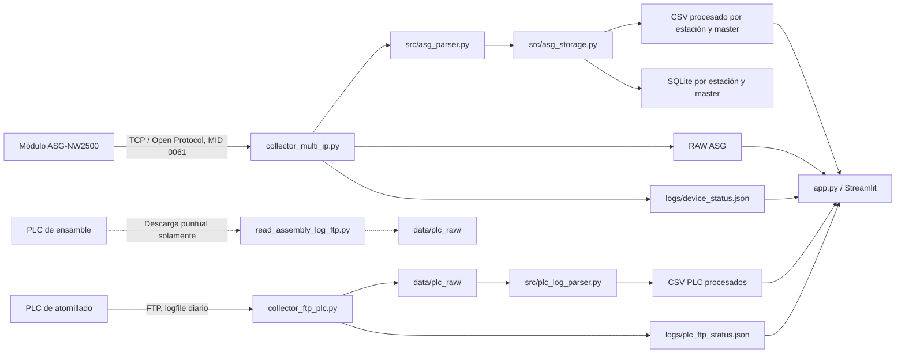

# ASG Data Acquisition SPC F09

Aplicación local para adquirir, procesar y consultar información de producción
de la línea F09. El sistema nació para recolectar resultados de módulos de
atornillado ASG-NW2500; posteriormente se agregó la descarga de los logfiles que
los PLC de esas estaciones publican por FTP.

Este documento describe lo que **hace actualmente el código**, cómo ejecutarlo
y dónde continuar el desarrollo. No asumas que una función planeada ya está
implementada: las limitaciones conocidas se anotan al final.

## Alcance actual

- **Atornillado:** adquisición directa desde ASG por TCP/Open Protocol y descarga
  del logfile del PLC asociado por FTP. Los datos procesados alimentan el
  dashboard y la trazabilidad.
- **PLC de ensamble:** existe un lector manual para descargar un logfile de un
  PLC y guardar la copia original. Todavía no existe un colector continuo,
  parser de ensamble ni una vista de piezas OK/NG para esas estaciones.
- **Modelos de producto:** T1XX-1 y T1XX-2.
- **Ejecución:** aplicación local para Windows. El dashboard Streamlit se sirve
  en `http://localhost:8502`.

## Arquitectura y flujo de datos



### Fuente ASG

`collector_multi_ip.py` crea un worker por cada ASG habilitado para el modelo
seleccionado. `src/asg_acop.py` abre la conexión TCP (puerto 4545 por defecto),
inicia Open Protocol (MID 0001), solicita resultados de atornillado (MID 0060),
recibe resultados MID 0061, confirma su recepción con MID 0062 y envía keepalive
MID 9999. Un fallo de conexión se reintenta con espera progresiva sin detener
los demás workers.

`src/asg_parser.py` interpreta MID 0061 Rev 001: estados de apriete, torque,
ángulo, identificadores, VIN, timestamps y metadatos. También compara las
mediciones con sus límites y registra el resultado de esa validación junto al
estado informado por el ASG. `src/asg_storage.py` guarda el paquete RAW y los
resultados limpios.

### Fuente PLC por FTP

`collector_ftp_plc.py` consulta en paralelo los PLC habilitados cada 10 segundos
por defecto. Actualmente usa FTP estándar, modo pasivo, y espera encontrar el
log diario en:

```text
/0_CARD/Atornillado_AAMM/AAMMDD_Log.csv
```

Ejemplo para el 21 de octubre de 2026:

```text
/0_CARD/Atornillado_2610/261021_Log.csv
```

El colector descarga el archivo completo la primera vez. Si el archivo remoto
creció, intenta reanudar desde el tamaño local; cuando el PLC no admite esa
operación, descarga el archivo completo. Si los tamaños coinciden, no vuelve a
descargarlo. La transferencia se escribe a un temporal y se renombra al terminar
para no sustituir una copia válida con una descarga parcial.

Después de una descarga nueva o modificada, el colector llama a
`src/plc_log_parser.py`. Ese parser es **específico del formato actual de los PLC
de atornillado**: espera filas CSV de 660 columnas, bloques de datos para hasta
30 aprietes y metadatos en posiciones fijas. No es un parser genérico de PLC.

El FTP configurado es FTP sin TLS (no FTPS); sus credenciales y datos no están
cifrados por el protocolo. Úsalo únicamente en la red autorizada de la planta.
No guardes contraseñas en el repositorio ni en los CSV de configuración.

## Estructura del repositorio

| Archivo o carpeta | Responsabilidad |
|---|---|
| `app.py` | Dashboard Streamlit, filtros, vistas, trazabilidad y cálculos de ciclo/capacidad/MSA. |
| `asg_launcher.py` | Interfaz Tkinter para iniciar dashboard, colectores y abrir el navegador. |
| `collector_multi_ip.py` | Workers TCP para adquirir datos en vivo de ASG. |
| `collector_ftp_plc.py` | Descarga continua de logfiles PLC de atornillado y actualización de estado FTP. |
| `check_ftp_stations.py` | Prueba de conexión, login, acceso/listado de carpeta y presencia del log diario; no descarga. |
| `read_assembly_log_ftp.py` | Descarga puntual de un logfile para inspeccionar un PLC de ensamble; no interpreta su contenido. |
| `diagnose_system.py` | Diagnóstico local de configuración, estados guardados y algunos conteos del día. |
| `config/asg_devices.csv` | Inventario de módulos ASG y asignación de estaciones/modelos. |
| `config/plc_devices.csv` | Inventario de PLC consultados por FTP. |
| `src/asg_acop.py` | Construcción y comunicación de paquetes Open Protocol/ACOP. |
| `src/asg_config.py` | Lectura y filtrado por modelo del inventario ASG. |
| `src/asg_parser.py` | Conversión de paquetes ASG RAW a resultados estructurados. |
| `src/asg_storage.py` | Esquema de columnas, rutas y escritura de CSV/SQLite para ASG. |
| `src/plc_config.py` | Lectura y validación del inventario de PLC. |
| `src/plc_log_parser.py` | Parser fijo de los logfiles PLC de atornillado y generación de CSV procesados. |
| `data/` | Archivos RAW y procesados locales; las carpetas de producción se ignoran en Git. |
| `logs/` | Logs, estado de conexión, selección del launcher y sesión de conteo; ignorados en Git. |
| `docs/` | Resumen ejecutivo, material de presentación y checklist del proyecto. |
| `readme.txt` | Bitácora corta de cambios y notas para retomar el trabajo. |
| `VERSION.md` | Notas de versión existentes; revisar fecha y vigencia al publicar cambios. |
| `requirements.txt` | Dependencias Python fijadas para crear el entorno. |

No se encontró una suite de pruebas automatizada en el repositorio. Antes de
modificar parsers, usa los logfiles de ejemplo disponibles o crea pruebas
aisladas con copias de datos, y no sobrescribas archivos de producción.

## Preparación del entorno

Requisitos:

- Windows y Python 3.12 o superior (requisito de las dependencias fijadas,
  incluida NumPy 2.5.1).
- Python Launcher disponible como comando `py`.
- Acceso a la red de planta para conectarse con los ASG/PLC.
- Para el dashboard: dependencias de `requirements.txt` (incluye Streamlit,
  pandas y Plotly).

Los archivos `.bat` llaman a `setup_environment.bat`. En el primer inicio, este
script crea `.venv` con `py -3` e instala `requirements.txt`; los siguientes
inicios reutilizan ese entorno. La carpeta `.venv` está excluida de Git. Si se
modifica `requirements.txt`, actualiza el entorno manualmente:

```bat
cd C:\ruta\al\repositorio
py -3 -m venv .venv
.venv\Scripts\python.exe -m pip install -r requirements.txt
```

Si el entorno ya existe, omite el comando `venv` y ejecuta solo la instalación
con pip. Evita depender del alias `python.exe` de WindowsApps; usa el intérprete
de `.venv`.

## Formas de ejecución

### Sistema completo

Ejecuta `run_launcher.bat`. En el launcher:

1. Selecciona T1XX-1 o T1XX-2.
2. Selecciona el modo de conteo: preguntar, conteo nuevo o continuar el actual.
3. Pulsa **Iniciar sistema completo**.

El launcher abre ventanas separadas para el dashboard, el colector ASG y el
colector FTP de PLC. Cada proceso se puede iniciar también de forma
independiente. El launcher solicita credenciales al iniciar el proceso FTP si
no están configuradas en el entorno.

### Dashboard solamente

```bat
run_dashboard.bat
```

O directamente:

```bat
.venv\Scripts\python.exe -m streamlit run app.py --server.port 8502
```

Abre `http://localhost:8502`. La aplicación lee archivos locales; el dashboard
no inicia por sí mismo los colectores. Para tener datos recientes, los
colectores correspondientes deben estar corriendo.

Las vistas de la barra lateral son **Vista general**, **Dashboard por estación**,
**Trazabilidad QR**, **Tiempos de ciclo**, **Capacidad**, **MSA**, **Tabla de
datos**, **Configuración** y **Acerca del sistema**. Los controles permiten
filtrar modelo, estación, resultado y ventana de tiempo. La vista general
muestra además el estado FTP guardado por el colector.

### Colector ASG

Scripts rápidos:

```bat
run_collector_T1XX1.bat
run_collector_T1XX2.bat
```

O por línea de comandos:

```bat
.venv\Scripts\python.exe collector_multi_ip.py --model T1XX-1
.venv\Scripts\python.exe collector_multi_ip.py --model T1XX-2
```

Opciones adicionales:

- `--new-count`: fuerza una sesión nueva de conteo.
- `--continue-count`: continúa la sesión existente sin preguntar.

Sin estas opciones, el colector puede solicitar el modo de conteo. No ejecutes
varios colectores ASG para el mismo modelo al mismo tiempo: cada proceso crea
conexiones y sesiones de producción independientes.

### Colector PLC/FTP continuo

Desde el launcher, pulsa **Solo iniciar Colector PLC / FTP**, o ejecuta:

```bat
.venv\Scripts\python.exe collector_ftp_plc.py --model T1XX-1
.venv\Scripts\python.exe collector_ftp_plc.py --model T1XX-2
```

Opciones del colector:

- `--model T1XX-1|T1XX-2`: limita los PLC a los modelos indicados. Si se omite,
  selecciona todos los PLC habilitados.
- `--device PLC_01`: limita a un PLC. Puede repetirse para elegir varios.
- `--interval 10`: intervalo entre ciclos en segundos; mínimo permitido: 2.
- `--timeout 8`: timeout de conexión por PLC.
- `--date AAAA-MM-DD`: consulta esa fecha en vez de la fecha actual.
- `--once`: hace un ciclo y termina.

El launcher pasa el modelo seleccionado y un intervalo de 10 segundos. El
colector procesa los logs de atornillado después de cada ciclo cuando hay
cambios, y al menos una vez si todavía no existen todos los CSV de salida.
Detén un colector con `Ctrl+C`.

### Probar conexiones FTP sin descargar

```bat
.venv\Scripts\python.exe check_ftp_stations.py
.venv\Scripts\python.exe check_ftp_stations.py --date 2026-10-21 --timeout 12
```

Verifica todos los PLC habilitados en `config/plc_devices.csv`: conexión,
autenticación, acceso a carpeta, listado pasivo y existencia del logfile del día.
Esta comprobación **no descarga ni modifica archivos**. Su ruta de carpeta está
fijada al patrón actual de atornillado; por eso no demuestra que un PLC de
ensamble use el mismo patrón.

### Prueba puntual de logfile de ensamble

Para iniciar el lector en modo interactivo, ejecuta sin argumentos:

```bat
.venv\Scripts\python.exe read_assembly_log_ftp.py
```

El programa pregunta la IP y el puerto FTP (Enter acepta el puerto 21), luego
solicita el usuario y la contraseña (la contraseña no se muestra mientras se
escribe). Crea automáticamente un identificador local a partir de la IP y
guarda el logfile en `data\plc_raw\<ID>\`. Este modo solicita credenciales en
cada ejecución y no utiliza las variables de entorno.

También se puede indicar un equipo registrado en `config/plc_devices.csv`:

```bat
.venv\Scripts\python.exe read_assembly_log_ftp.py --device PLC_11
```

O indicar la IP directamente para evitar las preguntas de IP y puerto:

```bat
.venv\Scripts\python.exe read_assembly_log_ftp.py --ip IP_DEL_PLC --port 21 --device-id ENSAMBLE_01
```

En estos modos explícitos, las credenciales se leen de `SPC_PLC_FTP_USER` y
`SPC_PLC_FTP_PASSWORD` cuando están definidas; si faltan, el programa las solicita.

El lector solicita fecha y ruta por omisión usando el patrón de atornillado.
Para PLC de ensamble que use otra estructura, especifica las opciones:

```bat
.venv\Scripts\python.exe read_assembly_log_ftp.py --ip IP_DEL_PLC --port 21 --device-id ENSAMBLE_01 --remote-dir /RUTA/REMOTA --remote-name archivo.csv
```

En todos los modos se pueden pasar `--date AAAA-MM-DD`, `--timeout SEGUNDOS`,
`--remote-dir` y `--remote-name`. La descarga se guarda en
`data/plc_raw/<ID>/<nombre>`, primero en un archivo temporal y luego como
archivo final. El script **no interpreta** QR, estado de pieza, ni resultados;
el archivo debe revisarse para documentar su formato antes de diseñar un parser.

## Credenciales y conectividad

El colector y las herramientas FTP reconocen estas variables de entorno:

- `SPC_PLC_FTP_USER`
- `SPC_PLC_FTP_PASSWORD`

Si faltan, solicitan usuario y contraseña al arrancar. En PowerShell se pueden
definir temporalmente para la sesión actual (sustituye los valores localmente;
no los guardes en archivos versionados):

```powershell
$env:SPC_PLC_FTP_USER = "USUARIO"
$env:SPC_PLC_FTP_PASSWORD = "CONTRASEÑA"
```

Los dispositivos y direcciones IP están en los CSV de configuración. El FTP
requiere conectividad de red hasta el PLC y acceso del usuario al directorio
remoto. El colector activa modo pasivo; firewalls y PLC deben permitir la
conexión de datos pasiva además del puerto de control FTP.

## Configuración de estaciones

### `config/asg_devices.csv`

Una fila por módulo ASG. Columnas:

- `enabled`: `1` habilita el equipo; `0` lo excluye.
- `device_id`: identificador estable, por ejemplo `ASG_01`.
- `station`, `module_name`, `process`: nombre de estación, número de módulo y
  código de proceso.
- `ip`, `port`: dirección y puerto TCP del módulo (actualmente 4545).
- `models`: modelos separados por `|`, por ejemplo `T1XX-1|T1XX-2`.
- `station_type`: `shared` o `exclusive`, según la asignación del modelo.
- `torque_unit`: unidad para el torque.
- `screws_per_piece_t1xx1`, `screws_per_piece_t1xx2`: cantidad esperada de
  aprietes por pieza/modelo, usada por conteos y análisis.

`src/asg_config.py` carga este CSV, valida las columnas requeridas y filtra los
dispositivos habilitados por modelo.

### `config/plc_devices.csv`

Una fila por PLC FTP. Contiene `enabled`, `device_id`, `station`, `module_name`,
`ip`, `ftp_port`, `models`, `process`, `station_type`, `torque_unit`,
`screws_per_piece_t1xx1` y `screws_per_piece_t1xx2`. La configuración actual
registra PLC_01 a PLC_12; las estaciones nuevas PLC_11/PLC_12 son clones
compartidos para ambos modelos. Para el flujo de atornillado, los sufijos de ID
PLC/ASG se corresponden y la estación/módulo/proceso debe representar el mismo
punto de operación. Mantén IDs e IPs únicos.

`src/plc_config.py` comprueba columnas, campos mínimos, puerto numérico y
duplicados de IDs/IP. El colector filtra por la columna `models`. El parser PLC
también usa los tornillos configurados si el logfile no declara el número.

No agregues un PLC de ensamble a este inventario de atornillado sin verificar
antes la arquitectura: el colector actual exige columnas asociadas con torque,
selecciona PLC por modelo y envía todo archivo descargado al parser fijo de
atornillado. Los PLC de ensamble requieren un tipo de equipo y un parser/flujo
separados o una extensión deliberada de este contrato.

## Archivos generados

| Ruta | Contenido |
|---|---|
| `data/raw_live/asg_raw_live_AAAA-MM-DD.csv` | Paquetes RAW recibidos de ASG. |
| `data/stations/<modelo>/<estación>/raw/asg_raw_AAAA-MM-DD.csv` | RAW de ASG separado por estación/modelo. |
| `data/processed/asg_clean_master_AAAA-MM-DD.csv` | Resultados ASG normalizados del día. |
| `data/stations/<modelo>/<estación>/processed/asg_clean_AAAA-MM-DD.csv` | Resultados normalizados por estación. |
| `database/asg_torque_master.db` | Base SQLite master de resultados ASG. |
| `data/stations/<modelo>/<estación>/database/asg_torque.db` | Base SQLite de la estación. |
| `data/plc_raw/<PLC>/AAMMDD_Log.csv` | Copia local original del logfile PLC descargado. |
| `data/plc_processed/plc_piece_attempts_master_AAAA-MM-DD.csv` | Todos los intentos por QR/estación. |
| `data/plc_processed/plc_pieces_master_AAAA-MM-DD.csv` | Intento final por QR/estación. |
| `data/plc_processed/plc_tightenings_master_AAAA-MM-DD.csv` | Detalle de los aprietes individuales. |
| `logs/device_status.json` | Estado y contadores de conexiones ASG. |
| `logs/plc_ftp_status.json` | Último estado FTP por PLC, tamaños, errores y ruta local/remota. |
| `logs/collector.log`, `logs/collector_ftp_plc.log` | Registro operativo de los colectores. |
| `logs/production_session.json` | Sesiones activas/anteriores de conteo por modelo. |
| `logs/launcher_selection.json` | Modelo y modo elegidos en el launcher. |

`AAAA-MM-DD` representa la fecha ISO, por ejemplo `2026-10-21`. Los logfiles RAW
FTP conservan el nombre remoto `AAMMDD_Log.csv`.

El parser PLC lee filas de 660 columnas. Los primeros datos identifican hora y
QR; bloques de ancho fijo representan aprietes; campos de metadatos contienen,
entre otros, modelo y número declarado de tornillos. Cada intento se clasifica
como `OK`, `NG` o `INCOMPLETE`. Repeticiones del mismo QR en una estación se
numeran cronológicamente y se marca un intento final. `plc_pieces_master` toma
ese intento final; `plc_piece_attempts_master` conserva todos para trazabilidad.
El detalle y sus reglas se encuentran en `src/plc_log_parser.py`.

Las carpetas de producción, logs, bases SQLite, entornos virtuales y temporales
están excluidas de Git por `.gitignore`. Esto mantiene el repositorio pequeño y
evita subir datos operativos. Configuración y código sí se versionan.

## Diagnóstico y solución de problemas

### Los `.bat` dicen que no encuentran Python

Confirma que `py -3 --version` funciona. No uses el alias `python.exe` de
WindowsApps. Ejecuta `setup_environment.bat` desde la carpeta del repositorio
para crear/instalar `.venv`; después los launchers usan explícitamente
`.venv\Scripts\python.exe`.

### El launcher dice que faltan archivos

Debe existir `app.py`, ambos colectores, `config/asg_devices.csv` y
`config/plc_devices.csv`. El colector FTP también importa
`src/plc_config.py` y `src/plc_log_parser.py`; ambos deben estar presentes.

### FTP conecta, pero no encuentra el logfile (`550`)

`550 No such file or directory` suele significar que la ruta/archivo solicitado
no existe o no es accesible para el usuario FTP. Confirma en el PLC el nombre del
log, la carpeta del mes, que el archivo ya se haya creado ese día y los permisos.
El colector de atornillado usa la ruta fija `/0_CARD/Atornillado_AAMM/`.
`check_ftp_stations.py` comprueba el patrón actual; para otra ruta usa el lector
puntual con `--remote-dir` y `--remote-name`.

### Conexiones fallidas o autenticación

Separa estos casos al revisar `logs/plc_ftp_status.json` y
`logs/collector_ftp_plc.log`: red/puerto inaccesible, credenciales rechazadas,
directorio inaccesible, logfile ausente o formato de transferencia no soportado.
El estado se reescribe por ciclo. No compartas contraseñas ni registres su valor
en logs o capturas.

### FTP descarga, pero el dashboard no cambia

Verifica que el colector siga vivo, que `logs/plc_ftp_status.json` se actualice
y que `data/plc_raw/<PLC>/` tenga el logfile. Revisa también si los CSV
procesados cambian en `data/plc_processed/`, el modelo seleccionado y los
filtros de la vista del dashboard. La vista PLC existente filtra PLCs usando los
IDs ASG correspondientes (`ASG_N` ↔ `PLC_N`).

### Diagnóstico del inventario

Ejecuta el diagnóstico indicando un solo modelo:

```bat
.venv\Scripts\python.exe diagnose_system.py --model T1XX-1
.venv\Scripts\python.exe diagnose_system.py --model T1XX-2
```

Valida IPs, puertos y correspondencia de estaciones en las tablas ASG/PLC y
muestra estados/conteos locales; no inicia conexiones a los equipos. Actualmente
contiene cantidades esperadas fijas para los inventarios anteriores (6 ASG/PLC
para T1XX-1 y 8 para T1XX-2); como el CSV actual incluye los clones ASG_11/12 y
PLC_11/12, este diagnóstico puede reportar un conteo incorrecto hasta actualizar
esa constante. No interpretes ese aviso de cantidad como un fallo de FTP.

## Notas para futuros cambios

1. Conserva por separado la fuente directa ASG y la fuente FTP; ambas pueden
   representar el mismo proceso de atornillado. No sumes registros de ambas
   fuentes como piezas independientes sin una regla de correlación/deduplicación.
2. Antes de generalizar FTP a ensamble, consigue un logfile real de esa clase de
   PLC y documenta ruta, nombre, codificación, delimitador, columnas, definición
   de QR y reglas de OK/NG. No reutilices `src/plc_log_parser.py` a menos que el
   formato sea realmente el mismo.
3. El lector puntual `read_assembly_log_ftp.py` es una herramienta de
   exploración, no el flujo de adquisición permanente: descarga un solo archivo
   por ejecución, lo guarda como RAW y no produce piezas procesadas ni dashboard.
4. Mantén la descarga de archivos atómica, reporta errores originales y no
   ocultes fallos de FTP durante la limpieza de conexiones.
5. Actualiza este `README.md` y la bitácora `readme.txt` cuando cambien comandos,
   rutas, configuración o alcance. No añadas credenciales ni datos reales
   sensibles a documentación versionada.

## Documentación adicional

- `VERSION.md`: notas de versión.
- `docs/RESUMEN_EJECUTIVO.md`: objetivo y beneficios.
- `docs/PITCH_GERENCIA.md`: material de presentación.
- `docs/CHECKLIST_ANTES_DE_COMPARTIR.md`: revisión antes de compartir el proyecto.

## Autor

Ing. Oswaldo Cantú Casillas
